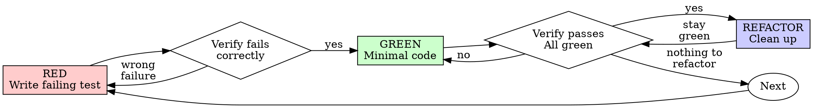

# Test-Driven Development (TDD)

## Overview

Write the test first. Watch it fail. Write minimal code to pass.

**Core principle:** If you didn't watch the test fail, you don't know if it tests the right thing.

**Violating the letter of the rules is violating the spirit of the rules.**

## When to Use

**Always:**

- New features
- Bug fixes
- Refactoring
- Behaviour changes

**Exceptions (ask your human partner):**

- Throwaway prototypes
- Generated code
- Configuration with no logic. Configuration that changes behaviour (CI workflows, infrastructure as
  code, feature flags) gets a test of that behaviour.

Where no person can be asked (a subagent or an unattended run), record the exception and its reason.
If you write the pull request description, put it in the Testing section. If you do not, put it in
your report; the agent that writes the description carries it into Testing. Never decide it
silently.

**These earn no test, and need no permission:**

- Prose for humans.
- Trivial code. Constructors, getters, constants and trivial forwarding earn a test only when they
  validate, normalise, default, derive, enforce, branch or cause a side effect.

Documents that instruct agents (skills, prompts) do earn a test: run the consuming agent, rather
than asserting their text. That test needs no permission either.

Thinking "skip TDD just this once"? Stop. That's rationalisation.

## Agentic Delivery rules

These bind in addition to the loop, and a reviewer will hold you to them.

- **Tests ship in the same pull request as the behaviour they cover**, never a follow-up. A reviewer
  must reject a pull request that adds or changes behaviour without them.
- **Tests live where the language's convention puts them, separate from shipped code.** That is a
  test file, or a test-only module such as Rust's `#[cfg(test)] mod tests`. Production code paths
  never contain test logic. Documentation tests (Python doctests, Rust doc-tests) stay where the
  language runs them, in docstrings and doc comments.
- **A pure refactoring pull request is covered by tests that already exist.** Where they do not, add
  them in a separate pull request first, so the refactor can be shown to leave behaviour unchanged.
- **80% line coverage per project is a floor, not a goal.** Meaningful tests over edge cases and
  failure paths matter more than the number. Where CI checks it, a pull request that drops below the
  threshold does not merge. If the project defines a coverage command, run it before you hand over
  and quote the figure in the pull request's Testing section. If it defines none, add no tooling and
  write "coverage not measured: the project defines no coverage command" in the Testing section.
  Genuinely hard-to-test paths are an exception, should be rare, and belong in the pull request
  description.

## The Iron Law

```text
NO PRODUCTION CODE WITHOUT A FAILING TEST FIRST
```

Did you write production code for this task before its test? Delete it, whether committed or not, by
reverting your own changes. Start over.

**No exceptions:**

- Don't keep it as "reference"
- Don't "adapt" it while writing tests
- Don't look at it
- Delete means delete

Implement fresh from tests. Period.

This covers only code you wrote for this task. Never delete code written outside it — a person's
uncommitted work, a teammate's branch, an earlier session's output — without asking first. Where a
file also holds uncommitted changes you did not make, remove only your own hunks, or ask first.
Never run `git restore` or `git checkout -- <file>` on such a file.

## Red-Green-Refactor



Before you write the task's first test, run the full suite or the project's documented check command
and keep its output. Note its failures, errors and warnings. This is the "before" that Verify GREEN
compares against. Run it first because a test that imports a missing symbol breaks the run itself:
pytest stops at a collection error and Go fails to build the package.

### RED - Write Failing Test

Write one minimal test showing what should happen.

**Good** — clear name, tests real behaviour, one thing:

```typescript
test("retries failed operations 3 times", async () => {
  let attempts = 0;
  const operation = async () => {
    attempts++;
    if (attempts < 3) throw new Error("fail");
    return "success";
  };

  const result = await retryOperation(operation);

  expect(result).toBe("success");
  expect(attempts).toBe(3);
});
```

**Bad** — vague name, never checks the result:

```typescript
test("retry works", async () => {
  let attempts = 0;
  const operation = async () => {
    attempts++;
    if (attempts < 3) throw new Error("fail");
    return "success";
  };

  await retryOperation(operation);

  expect(attempts).toBe(3);
});
```

**Requirements:**

- One behaviour
- Clear name
- Real code (no mocks unless unavoidable)

### Verify RED - Watch It Fail

**MANDATORY. Never skip.** Run the repository's own test runner — `pytest`, `go test`, `cargo test`,
`npm test`, whatever the project uses:

```text
<test runner> <the test file you just wrote>
```

Confirm:

- Test fails on its assertion, or on a stub's "not implemented" error
- Failure message is expected
- Fails because feature missing (not typos)

**Test of new behaviour:** it must fail first. If it passes, it tests existing behaviour. Fix the
test.

**Characterisation test of existing behaviour** (pinning behaviour before a refactor): it should
pass first time. Prove it can fail instead. Temporarily break the production code, watch the test
fail, then restore the code. Run it: a mental mutation is not evidence. Restore by undoing your own
edit only, as the Iron Law says. See
[The Mutation Check](references/writing-good-tests.md#the-mutation-check). A test that still passes
with the code broken proves nothing.

**Missing symbol?** A compile error or `ImportError` for code that does not exist yet is the
expected first state. Add the smallest stub, with the right signature returning a zero value or
raising "not implemented", so the test compiles and fails. A failure on that "not implemented" error
is an expected RED; move on to GREEN. If the stub's zero value makes a test of new behaviour pass,
because the expected value is that zero value, change the stub's return value. Do not change the
test, and do not write the real implementation yet.

**Any other error?** Fix it, then re-run until the test fails correctly.

### GREEN - Minimal Code

Write simplest code to pass the test.

**Good** — just enough to pass:

```typescript
async function retryOperation<T>(fn: () => Promise<T>): Promise<T> {
  for (let i = 0; i < 3; i++) {
    try {
      return await fn();
    } catch (e) {
      if (i === 2) throw e;
    }
  }
  throw new Error("unreachable");
}
```

**Bad** — over-engineered:

```typescript
async function retryOperation<T>(
  fn: () => Promise<T>,
  options?: {
    maxRetries?: number;
    backoff?: "linear" | "exponential";
    onRetry?: (attempt: number) => void;
  },
): Promise<T> {
  // YAGNI
}
```

Don't add features, refactor other code, or "improve" beyond the test.

### Verify GREEN - Watch It Pass

**MANDATORY.**

```text
<test runner> <the test file you just wrote>
<test runner or the project's documented check command, for the full suite>
```

Run the new test file first, then the full suite or the project's documented check command. Do this
before the cycle ends and before you report the work complete.

Confirm:

- Test passes
- No test fails that passed in the run before your first test; report any that already failed
- No new errors or warnings compared with the output recorded before your first test

**Test fails?** Fix code, not test.

**Other tests fail?** Fix now, if they passed in the run before your first test. A failure that was
already there is not yours: report it, and do not fix it in this change.

**Warnings that were already there?** Note them. Do not fix them in this change.

### REFACTOR - Clean Up

After green only:

- Remove duplication
- Improve names
- Extract helpers

Keep tests green. Don't add behaviour.

### Repeat

Next failing test for next feature.

## Good Tests

| Quality          | Good                                | Bad                                                 |
| ---------------- | ----------------------------------- | --------------------------------------------------- |
| **Minimal**      | One thing. "and" in name? Split it. | `test('validates email and domain and whitespace')` |
| **Clear**        | Name describes behaviour            | `test('test1')`                                     |
| **Shows intent** | Demonstrates desired API            | Obscures what code should do                        |

When writing or changing any test, read
[references/writing-good-tests.md](references/writing-good-tests.md) for the rules that keep tests
honest:

- Name the production change that would make the test fail — before writing it
- Assert on real behaviour, never on the mock's presence or the responses you configured it with
- Keep test-only code in test utilities, out of production classes
- Understand a dependency's side effects before mocking it

## Common Rationalisations

| Excuse                                               | Reality                                                                                                                                                                                                                                                                              |
| ---------------------------------------------------- | ------------------------------------------------------------------------------------------------------------------------------------------------------------------------------------------------------------------------------------------------------------------------------------ |
| "Too simple to test"                                 | Code that validates, normalises, defaults, derives, enforces, branches or has a side effect is not too simple: it breaks, and the test takes 30 seconds. Only trivial code and prose earn no test, and agent-instruction documents are tested by running the consuming agent.        |
| "I'll test after"                                    | Tests written after pass immediately — which proves nothing. They may test the wrong thing, test the implementation instead of the behaviour, or miss the edge case you forgot. You never watched it fail, so you never proved it can catch the bug. Test-first forces that failure. |
| "Tests after achieve same goals (spirit not ritual)" | Tests-after answer "what does this do?"; tests-first answer "what should this do?" Tests written after are biased by the code you already wrote — you verify the cases you remembered, not the ones you'd have discovered. Coverage without proof the tests work.                    |
| "Already manually tested"                            | Manual testing is ad-hoc: no record of what you covered, no way to re-run it when the code changes, easy to forget cases under pressure. "Worked when I tried it" ≠ comprehensive. Automated tests run the same way every time.                                                      |
| "Deleting X hours is wasteful"                       | Sunk cost fallacy — that time is already spent either way. The real choice: rewrite your own untested code from this task with TDD (high confidence) vs. keep it and bolt tests on after (low confidence, likely bugs). Keeping code you can't trust is the waste.                   |
| "Keep as reference, write tests first"               | You'll adapt it. That's testing after. Delete your own untested code from this task; delete means delete.                                                                                                                                                                            |
| "Need to explore first"                              | Fine. Throw away exploration, start with TDD.                                                                                                                                                                                                                                        |
| "Test hard = design unclear"                         | Listen to test. Hard to test = hard to use.                                                                                                                                                                                                                                          |
| "TDD will slow me down"                              | TDD IS the pragmatic path: catches bugs before commit, prevents regressions, lets you refactor without fear. "Pragmatic" shortcuts mean debugging in production — slower, not faster.                                                                                                |
| "Manual test faster"                                 | Manual doesn't prove edge cases. You'll re-test every change.                                                                                                                                                                                                                        |
| "Existing code has no tests"                         | You're improving it. Add tests for existing code.                                                                                                                                                                                                                                    |

## Red Flags - STOP and Start Over

- Code before test
- Test after implementation
- A test of new behaviour passes immediately
- Can't explain why test failed
- Tests added "later"
- Rationalizing "just this once"
- "I already manually tested it"
- "Tests after achieve the same purpose"
- "It's about spirit not ritual"
- "Keep as reference" or "adapt existing code"
- "Already spent X hours, deleting is wasteful"
- "TDD is dogmatic, I'm being pragmatic"
- "This is different because..."

**All of these mean: delete your own untested code from this task. Start over with TDD.** A
characterisation test that passes first time is not a red flag; prove it by running it against
temporarily broken production code and watching it fail.

## Example: Bug Fix

**Bug:** Empty email accepted

**RED** — write the failing test:

```typescript
test("rejects empty email", async () => {
  const result = await submitForm({ email: "" });
  expect(result.error).toBe("Email required");
});
```

**Verify RED** — watch it fail for the right reason:

```bash
$ npm test
FAIL: expected 'Email required', got undefined
```

**GREEN** — write the minimum that passes:

```typescript
async function submitForm(data: { email?: string }) {
  if (!data.email) {
    return { error: "Email required" };
  }
  // ...
}
```

**Verify GREEN** — watch it pass:

```bash
$ npm test
PASS
```

**REFACTOR** Extract validation for multiple fields if needed.

## Verification Checklist

Before marking work complete:

- [ ] Every new behaviour has a test
- [ ] Watched each new-behaviour test fail before implementing
- [ ] Each new-behaviour test failed for expected reason (feature missing, not typo)
- [ ] Each characterisation test failed when the production code was temporarily broken, then passed
  once restored
- [ ] Wrote minimal code to pass each test
- [ ] No test fails that passed in the run before your first test; any that already failed are
  reported
- [ ] No new errors or warnings compared with the output recorded before your first test
- [ ] Tests use real code (mocks only if unavoidable)
- [ ] Edge cases and errors covered

Can't check all boxes? Fix the unchecked item, or state why it cannot be checked.

## When Stuck

| Problem                | Solution                                                             |
| ---------------------- | -------------------------------------------------------------------- |
| Don't know how to test | Write wished-for API. Write assertion first. Ask your human partner. |
| Test too complicated   | Design too complicated. Simplify interface.                          |
| Must mock everything   | Code too coupled. Use dependency injection.                          |
| Test setup huge        | Extract helpers. Still complex? Simplify design.                     |

## Debugging Integration

Bug found? Write failing test reproducing it. Follow TDD cycle. Test proves fix and prevents
regression.

Never fix bugs without a test.

## Final Rule

```text
Production code → test exists and failed first
Otherwise → not TDD
```

Where a person can be asked, take no exception without your human partner's permission. Where none
can, take the exception and record it and its reason in your report to whoever writes the pull
request description, or in its Testing section if you write it. Prose, trivial code and the test of
an agent-instruction document (running the consuming agent) are not exceptions and need no
permission.
